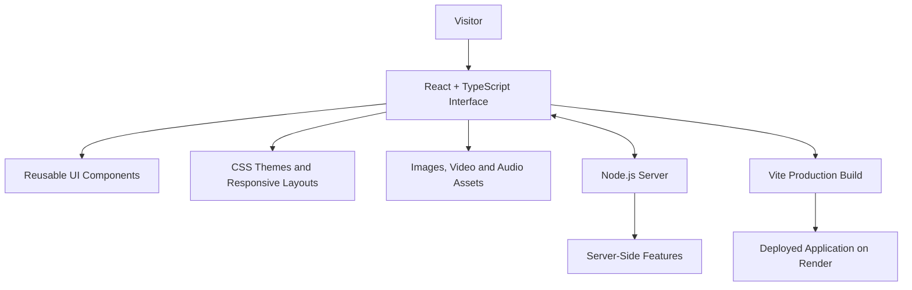

# 🌙 Pip’s Midnight Observatory

### *A little world between code and dreams.*

**Not just a portfolio. A universe to explore.**

Pip’s Midnight Observatory is an interactive, storybook-inspired web experience that blends creative frontend engineering, character-driven storytelling, atmospheric sound, animated visuals, and playful exploration into one cohesive digital world.

Built around Pip, a tiny dream-loving character, the experience invites visitors to explore a whimsical observatory, discover how dreams are made, interact with night-themed features, and end their journey in a peaceful Goodnight experience.

<p align="center">

  **🌐 [EXPLORE THE LIVE EXPERIENCE](https://pips-midnight-observatory-i8wr.onrender.com)**

  **💻 [VIEW SOURCE CODE ON GITHUB](https://github.com/ArunKumarValandas/pips-midnight-observatory)**

</p>

---

## ✨ The Experience at a Glance

| Experience | What makes it special |
|---|---|
| 🌌 **The Observatory** | An atmospheric entry into a character-driven digital world |
| 🌙 **Living Themes** | Switch between contrasting visual moods with day/night controls |
| 🎵 **Ambient Soundscape** | Background music and dedicated playback controls |
| 🧸 **Meet Pip** | A distinctive character at the heart of the experience |
| 🎼 **The Lullaby Lab** | A dream-inspired space that combines interactive presentation and audio |
| 🏮 **Nightlight Collection** | A themed visual collection presented as part of the dream world |
| ✉️ **Dream Delivery Routes** | A dream-themed exploration of the portfolio experience |
| 🌠 **Hidden Discoveries** | Playful interactions and secret-star Easter egg functionality |
| 💤 **The Goodnight Experience** | Sleeping Pip visuals, bedtime wishes, and a cozy closing experience |

*Page descriptions reflect the project's intended experience; individual interactions may vary with the current deployed implementation.*

---

## 🌠 01. The Vision — Turning a Portfolio into a World

Traditional portfolios primarily present information. Pip’s Midnight Observatory aims to make exploring that information an experience in itself.

Instead of relying on a conventional layout, the project uses a cohesive nighttime identity, a recurring character, atmospheric sound, visual storytelling, and interactive details to give the website a personality of its own.

### The design philosophy

- **Story before structure:** The interface feels like a journey through a fictional world.
- **Atmosphere through interaction:** Visual themes, animation, and sound contribute to the overall mood.
- **Personality in the details:** Small interactions make the experience feel playful and memorable.
- **Engineering behind the magic:** The visual experience is implemented as a real React application with typed source code and a production build process.

The goal is simple: make visitors remember not only what they saw, but how the experience felt.

---

## 🗺️ 02. Explore Pip’s Universe

### 🌌 The Observatory — Enter the World

<details>
<summary><strong>Explore the concept and experience</strong></summary>

The Observatory establishes the visual identity of the website. Its celestial atmosphere, character-focused presentation, and themed navigation introduce visitors to Pip’s world.

**Experience highlights**
- A distinctive nighttime visual identity.
- Navigation between themed areas of the website.
- Ambient music controls.
- Day/night visual modes.
- Animated and interactive design details.

**Purpose:** Create an immediate sense of place rather than presenting visitors with a conventional landing page.

</details>

### 🧸 Meet the Dream Engineer

<details>
<summary><strong>Discover the character behind the experience</strong></summary>

Pip provides the personality and narrative connection that ties the experience together.

The character's visual identity uses a cozy bedtime aesthetic, including a nightcap, stars, and a friendly expression. The broader design uses character-led storytelling to give the portfolio a recognizable identity.

**Purpose:** Make the website feel like a cohesive creative project with a character and a world, rather than a collection of unrelated sections.

</details>

### 🎼 The Lullaby Lab

<details>
<summary><strong>Explore the sound-focused experience</strong></summary>

The Lullaby Lab brings music and bedtime atmosphere into the observatory's dream-inspired world.

The project includes audio assets and a dedicated lullaby audio implementation. The website's audio design also includes coordination between the main ambient soundtrack and the Lullaby Lab playback experience.

**Audio behavior**
- Website-wide ambient music has pause and resume controls.
- The Lullaby Lab has its own music experience.
- When the Lullaby Lab audio takes over, the main ambient music is intended to pause and resume when the Lullaby Lab audio stops.

**Purpose:** Make audio part of the experience's interaction design rather than a disconnected media element.

</details>

### 🏮 Nightlight Collection

<details>
<summary><strong>A collection within the dream world</strong></summary>

The Nightlight Collection extends the visual storytelling through themed nightlight and lantern imagery.

The project includes dedicated Pip-related visual assets and lantern imagery used within its creative presentation.

**Purpose:** Give visitors another visual area to explore while maintaining the same nighttime identity.

</details>

### ✉️ Dream Delivery Routes

<details>
<summary><strong>Explore the dream-inspired journey</strong></summary>

Dream Delivery Routes forms part of the website's storybook approach to navigating the experience. It uses the concept of delivering dreams to connect the fictional world with the portfolio's exploration-focused structure.

**Purpose:** Reinforce the idea that navigation is part of a larger journey through Pip's world.

</details>

### 💤 The Goodnight Experience

<details>
<summary><strong>A peaceful ending to the journey</strong></summary>

The Goodnight page brings together the project's bedtime atmosphere, sleeping Pip visuals, and interactive closing elements.

**Experience elements**
- Sleeping Pip video or visual presentation.
- A sanctuary-inspired nighttime layout.
- Bedtime wish interactions.
- A guestbook area for visitor messages, where available.
- Navigation to other parts of the website.
- Responsive styling designed to keep the experience usable on smaller screens.

The page is designed to feel like the final chapter of a digital storybook: calm, personal, and consistent with the rest of the experience.

</details>

---

## 🎮 03. Interactive Features

The project's identity comes from the way its visual elements and controls work together.

### 🌗 Day and night themes

Switch between visual modes to change the atmosphere of the experience. The theme control is designed around the contrast between daylight and nighttime moods.

### 🎵 Website-wide music controls

Ambient music contributes to the observatory's atmosphere, with a dedicated control for pausing and resuming playback.

The audio experience is designed to coordinate with the Lullaby Lab rather than treating every sound as an unrelated background track.

### ✨ Stardust-inspired visual effects

The design incorporates atmospheric visual details intended to make interaction feel connected to the celestial setting.

### 🧭 Themed navigation

The website's navigation connects its themed pages while keeping the interface consistent with the fictional world.

### ⭐ Secret-star Easter egg

A hidden-star interaction adds a discovery element to the experience. The intention is to reward exploration without overwhelming the main interface.

### 💤 Bedtime wishes and guestbook

The Goodnight experience includes bedtime-themed interactions and a guestbook area, making the ending more participatory than a static closing screen.

### 📱 Responsive interface

The layout includes mobile-specific styling for the navbar, music controls, Goodnight content, interactive elements, and navigation buttons.

The aim is to preserve the visual experience while making controls easier to use on narrower screens.

---

## 🎨 04. Visual Identity and Design System

The website follows a **Pixel Storybook × Midnight Observatory** creative direction.

Its design combines an atmospheric nighttime world with selected retro-inspired details.

| Design element | Role in the experience |
|---|---|
| Midnight blues and indigo | Establish the observatory atmosphere |
| Moonlight and celestial accents | Reinforce the nighttime identity |
| Character illustrations | Give the world a recognizable personality |
| Pixel-inspired details | Add a subtle storybook and retro-game character |
| Motion and transitions | Bring interface elements to life |
| Sound and visual effects | Support immersion and emotional tone |
| Responsive layouts | Adapt the experience to different screen sizes |

Rather than using a generic visual theme, the project aims to maintain a recognizable identity across its pages, interactions, and closing experience.

---

## 🧠 05. Technology Stack

The project combines a modern frontend stack with a Node.js server.

| Technology | Role |
|---|---|
| **React** | Builds the interface using reusable components |
| **TypeScript** | Adds static typing to application code |
| **Vite** | Powers local development and production bundling |
| **CSS** | Implements visual styling, animations, themes, and responsive layouts |
| **Node.js** | Runs the project's server-side functionality |
| **Git and GitHub** | Version control and source-code hosting |
| **Render** | Hosts the deployed application |

### Why this stack?

React supports a component-based interface, TypeScript helps make code structure more explicit, and Vite provides a streamlined development and build workflow.

CSS gives the project control over its visual identity, responsive behavior, and atmospheric presentation. The Node.js server provides the runtime for the server functionality included in the repository.

---

## 🏗️ 06. Architecture Overview

The application separates the browser-facing experience from its server runtime.



**Architecture notes**

- The React interface presents the pages, controls, and interactive elements.
- CSS defines the visual presentation and responsive behavior.
- Static media assets supply the character artwork, animations, and audio.
- The Node.js server runs the server-side functionality included in the project.
- Vite compiles the application into production assets.

The diagram represents the major architectural roles; it is a high-level overview rather than a complete request-flow or deployment diagram.

---

## 🛠️ 07. Development and Deployment

The project is configured with scripts for development, production builds, linting, previewing, and running the Node.js server.

### Run locally

**Prerequisites:** Node.js and npm.

**1. Clone the repository**

```bash
git clone https://github.com/ArunKumarValandas/pips-midnight-observatory.git
cd pips-midnight-observatory
```

**2. Install dependencies**

```bash
npm install
```

**3. Start the development server**

```bash
npm run dev
```

Open the local URL printed in the terminal.

**4. Build for production**

```bash
npm run build
```

This runs the TypeScript project build and Vite production build.

**5. Run the configured server**

```bash
npm start
```

The project also provides `npm run server` for starting the Node.js server and `npm run lint` for running ESLint.

### Live deployment

- **Production website:** [Pip’s Midnight Observatory](https://pips-midnight-observatory-i8wr.onrender.com)
- **Source repository:** [GitHub](https://github.com/ArunKumarValandas/pips-midnight-observatory)

---

## 💡 08. Engineering Challenges and Learning

Building a visually rich experience involves more than creating a static design.

### Coordinating audio experiences

The ambient soundtrack and dedicated lullaby playback need to work together so that overlapping audio does not undermine the intended atmosphere.

### Maintaining responsive navigation

A character-driven design still needs practical navigation. Mobile layouts require careful spacing, touch-friendly controls, and adjustments to avoid content overflowing the viewport.

### Balancing motion and usability

Animations and visual effects should contribute to the atmosphere without making the interface difficult to navigate.

### Integrating media into a cohesive experience

Images, video, music, and interface elements need to feel like parts of one design system rather than separate additions.

### Preparing for production

The project includes a TypeScript and Vite production build and a configured Node.js server. Testing the production build and verifying the deployed website are important parts of delivery.

These challenges illustrate the combination of visual design, frontend implementation, interaction behavior, and deployment involved in the project.

---

## 🌟 09. What Makes This Project Different?

**Character-driven storytelling**

Pip gives the website a recognizable identity and a narrative thread that connects its pages.

**An atmosphere that extends beyond visuals**

Sound, animation, theme controls, and themed interactions contribute to a more immersive experience.

**A cohesive creative direction**

The observatory, dream-inspired sections, and Goodnight experience are designed to feel like parts of the same world.

**Functionality alongside aesthetics**

The project combines its creative presentation with navigation, interactive controls, a responsive layout, and server-side functionality.

**A real, deployed application**

The project is available online and has a public source repository, allowing visitors to explore the experience and developers to inspect the implementation.

The central idea is to treat a website not simply as a page to view, but as a world to discover.

---

## 🚀 10. Explore It Yourself

The best way to understand Pip’s Midnight Observatory is to experience it directly.

<p align="center">

### 🌙 Enter the Observatory

**[OPEN THE LIVE WEBSITE →](https://pips-midnight-observatory-i8wr.onrender.com)**

Explore the themes, discover the interactive elements, experience the soundscape, and visit the Goodnight page.

### 💻 Explore the Code

**[VIEW THE GITHUB REPOSITORY →](https://github.com/ArunKumarValandas/pips-midnight-observatory)**

</p>

---

## 👨‍💻 About the Developer

**Arun Kumar, Laxman Vky, Gaurav Kumar**

Creators and developers of Pip’s Midnight Observatory.

This project brings together frontend development, visual storytelling, interactive design, media integration, and deployment in a distinctive creative experience.

---

<p align="center">

**Made with code, stardust, and a little midnight magic. ✨**

*Pip’s Midnight Observatory — where technology meets imagination.*

</p>
